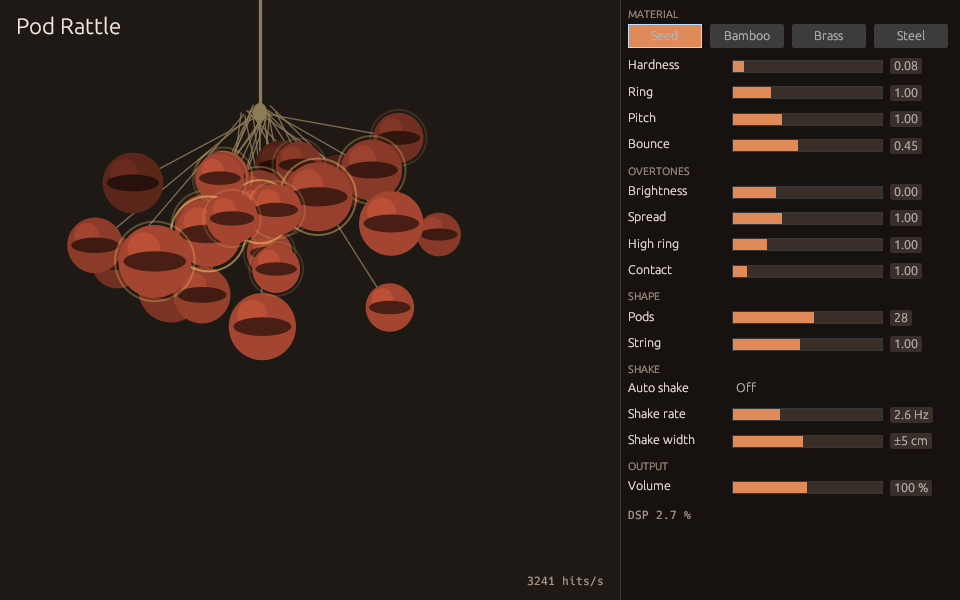

# masseater.dev

masseater が作ったものと書いた文章を載せる個人サイトである。

## 公開先

| 名前                                             | URL                                                                                                                                                                                                                                                                           |
| ------------------------------------------------ | ----------------------------------------------------------------------------------------------------------------------------------------------------------------------------------------------------------------------------------------------------------------------------- |
| サイト                                           | https://masseater.dev                                                                                                                                                                                                                                                         |
| Sloppedia                                        | https://masseater.dev/sloppedia/                                                                                                                                                                                                                                              |
| npm の sloppedia                                 | https://www.npmjs.com/package/sloppedia                                                                                                                                                                                                                                       |
| 単体のページ                                     | https://masseater.dev/satsuei-lab/（夕景カット撮影ラボ）、https://masseater.dev/split-pad/（背面打ちスプリットパッド）、https://masseater.dev/pod-rattle/（Pod Rattle）                                                                                                       |
| Pod Rattle の VST3 / CLAP プラグイン             | https://github.com/masseater/masseater.dev/releases?q=pod-rattle                                                                                                                                                                                                              |
| サムネのモザイクアート                           | https://masseater.dev/mosaic/                                                                                                                                                                                                                                                 |
| rpp-kit のデモ                                   | https://masseater.dev/rpp-kit/                                                                                                                                                                                                                                                |
| メドDB                                           | https://medley-manager.masseater.dev                                                                                                                                                                                                                                          |
| ニコニコ動画と YouTube の再生数の一覧（nimado）  | https://masseater.dev/nimado/                                                                                                                                                                                                                                                 |
| decision モデルの実験                            | https://masseater.dev/injection-bisect/ 、 https://masseater.dev/ocr-decide/ 、 https://masseater.dev/decision-bench/                                                                                                                                                         |
| npm の injection-bisect                          | https://www.npmjs.com/package/@r_masseater/injection-bisect                                                                                                                                                                                                                   |
| npm の watashi-cli                               | https://www.npmjs.com/package/@r_masseater/watashi-cli                                                                                                                                                                                                                        |
| npm の計測の部品                                 | https://www.npmjs.com/package/@r_masseater/vitest-otlp 、 https://www.npmjs.com/package/@r_masseater/web-vitals-flow 、 https://www.npmjs.com/package/@r_masseater/workers-tracing                                                                                            |
| npm の lint の部品                               | https://www.npmjs.com/package/@r_masseater/oxlint-plugin-decision 、 https://www.npmjs.com/package/@r_masseater/oxlint-plugin-decision-presets 、 https://www.npmjs.com/package/@r_masseater/oxlint-typed-rules 、 https://www.npmjs.com/package/@r_masseater/vite-plus-adopt |
| aredoko の管理アプリ                             | https://github.com/masseater/masseater.dev/releases?q=aredoko                                                                                                                                                                                                                 |
| RSS                                              | https://masseater.dev/feed.xml                                                                                                                                                                                                                                                |
| Standard.site                                    | https://bsky.app/profile/masseater.bsky.social                                                                                                                                                                                                                                |
| Zenn                                             | https://zenn.dev/masseater                                                                                                                                                                                                                                                    |
| 個人データの MCP サーバー（watashi-mcp）         | https://watashi.masseater.dev/mcp                                                                                                                                                                                                                                             |
| 自分用の雑多な道具の MCP サーバー（sundries）    | https://sundries.masseater.dev/mcp                                                                                                                                                                                                                                            |
| 声で答えるヒアリングの聞き手（kikite、本人だけ） | https://kikite.masseater.dev                                                                                                                                                                                                                                                  |

## aredoko

「あれどこだっけ」を見た目の言葉で探せる Unity エディタ拡張である。
プロジェクトや unitypackage に入っているモデル・テクスチャ・マテリアルを、「白いフリルのスカート」「古びた木の机」のような日本語で検索できる。
アセットと検索語は PC の外へ送らない。

動作環境は、VRChat Creator Companion が入れる Unity 2022.3.22f1 と、Windows 10・11 の 64 ビット版である。

### 導入

aredoko は、検索を受け持つ管理アプリと、Unity のエディタ拡張の 2 つでできている。

1. [Releases](https://github.com/masseater/masseater.dev/releases?q=aredoko) の `aredoko_x.y.z_x64-setup.exe` を実行する。管理アプリは起動するとタスクトレイに常駐する。
2. Unity の Window → Package Manager を開き、左上の「+」の「Add package from git URL...」に次の URL を入れる。

```text
https://github.com/masseater/masseater.dev.git?path=apps/aredoko-unity/Packages/dev.masseater.aredoko
```

### 使い方

| 手順           | 操作                                                      |
| -------------- | --------------------------------------------------------- |
| フォルダの登録 | 管理アプリの「探す場所」に unitypackage のフォルダを追加  |
| 索引の作成     | 登録すると始まり、サイドバーに進み具合が出る              |
| Unity で検索   | Window → aredoko → アセット検索（Ctrl+Shift+K）           |
| 取り込み       | unitypackage の中身はインポート、ほかはシーンへドラッグ   |
| BOOTH の情報   | 「ライブラリ」でパッケージを選び、商品ページの URL を登録 |

管理アプリの窓を閉じても、タスクトレイに残って検索を受け付ける。止めるときは、トレイのメニューから「終了」を選ぶ。

BOOTH の商品ページの URL を登録すると、商品名・ショップ名・タグでも検索できる。取得するのは誰でも見られる商品ページの公開情報だけで、ログイン情報や購入履歴には触れない。

## Pod Rattle

種のさやを紐に付けて振る楽器を、[Web のページ](https://masseater.dev/pod-rattle/)と、Rust と [nice-plug](https://codeberg.org/RustAudio/nice-plug) で作った VST3・CLAP のプラグインにしたものである。
サンプルは使わず、紐に付いたさやが 3D の剛体シミュレーションでぶつかり、その衝突が素材に合わせたモードの共振器を鳴らす。



### 導入

[Releases](https://github.com/masseater/masseater.dev/releases?q=pod-rattle) の zip に、Windows・macOS（universal）・Linux 向けの `Pod Rattle.vst3` と `Pod Rattle.clap` が入っている。それぞれをプラグインのフォルダに写す。

| OS      | VST3                                 | CLAP                                 |
| ------- | ------------------------------------ | ------------------------------------ |
| Windows | `C:\Program Files\Common Files\VST3` | `C:\Program Files\Common Files\CLAP` |
| macOS   | `~/Library/Audio/Plug-Ins/VST3`      | `~/Library/Audio/Plug-Ins/CLAP`      |
| Linux   | `~/.vst3`                            | `~/.clap`                            |

macOS 版はアドホック署名で公証していないので、写したあとに一度だけ quarantine の属性を外す。

```sh
xattr -dr com.apple.quarantine ~/Library/Audio/Plug-Ins/*/Pod\ Rattle.*
```

### 演奏

MIDI のノートを受けるたびに、ラトルを反対側へ振って戻す。強さはベロシティで決まる。**Auto shake** を入れると、ラトルは **Shake rate** の速さで勝手に振れ、ノートを無視する。エディタでラトルをドラッグして手で振ることもできる。4 つの素材のボタンは Web 版と同じプリセットを読み、スライダーはすべてホストから自動化できる。

### 計測

下の値はすべて、main への push ごとに CI が `vp run verify` で確かめる。

| 項目                           | 測り方                                                                                                                                                         | 結果                                                                                                                                           |
| ------------------------------ | -------------------------------------------------------------------------------------------------------------------------------------------------------------- | ---------------------------------------------------------------------------------------------------------------------------------------------- |
| Web 版と同じ音                 | `libs/pod-rattle-engine/tests/parity.rs` が、Web 版のページから切り出した JavaScript のエンジンを Node.js で鳴らした音と比べる                                 | 最初の 0.45〜1.3 秒は標本単位で一致（誤差 1e-9 以内）。その後は V8 と Rust の演算の最下位の差でずれ、100 ms ごとの音量は 0.93〜1.04 倍に収まる |
| オーディオスレッドで確保しない | `libs/pod-rattle-engine/tests/no_alloc.rs` の `assert_no_alloc` と、debug ビルドの nice-plug の `assert_process_allocs`                                        | 通る                                                                                                                                           |
| 命令数の上限                   | `libs/pod-rattle-engine/benches/instructions.rs` が gungraun 経由の Valgrind で数える（さや 48 個、96 kHz、最速の振り）。音声 1 秒あたり 20 億を超えると落ちる | 音声 1 秒あたり 17.2 億                                                                                                                        |
| 1 インスタンスの負荷           | `cargo bench -p pod-rattle-engine` が最速・最大の振りで 48 kHz の 1 秒を描く                                                                                   | さや 28 個で 20〜25 ms（1 コアの 2〜2.5 %）、48 個で 40〜50 ms                                                                                 |
| プラグインの適合               | 3 OS で strictness 10 の `pluginval`（VST3）、Linux と macOS で `clap-validator`                                                                               | `pod-rattle` ワークフローの `bundle` ジョブ                                                                                                    |

ベンチの値は 2.1 GHz の Intel Xeon で測った。エディタも DSP の負荷と 1 秒あたりの衝突の数を出す。

nice-plug とその VST3 のバインディングは ISC と MIT/Apache-2.0 で、AGPL のリポジトリと組み合わせて配れる。

## yakusu

[PLaMo 3 Translate 0.8B](https://huggingface.co/pfnet/plamo-3-translate-0.8b) を手元の PC で動かす翻訳アプリである。
文章を入れると、入力の手を止めたところで訳文が流れるように出る。訳す文章は PC の外へ出ない。

| 特徴               | 内容                                         |
| ------------------ | -------------------------------------------- |
| 言語の自動判定     | 原文の言語の判定と、日本語・英語の自動の切替 |
| 53 言語            | モデルカードに載っている言語すべて           |
| 日本語の文体の指定 | 自動・です・ます・であるの 3 つから選ぶ      |
| 長文の分割         | 1000 文字ごとに空行で区切って順に訳す        |

[Releases](https://github.com/masseater/masseater.dev/releases?q=yakusu) から、使う OS のファイルを落として開く。

| OS                     | ファイル                     |
| ---------------------- | ---------------------------- |
| Windows 10・11（x64）  | `yakusu_x.y.z_x64-setup.exe` |
| macOS（Apple Silicon） | `yakusu_x.y.z_aarch64.dmg`   |
| Linux（x64）           | `.deb` または `.AppImage`    |

インストーラーには [llama.cpp](https://github.com/ggml-org/llama.cpp) の llama-server が入っている。モデル（約 570 MB）は初回の起動で Hugging Face から取得するので、初回だけネットワークが要る。macOS では署名をしていないので、初回は Finder でアプリを右クリックして「開く」を選ぶ。

モデルは [PLaMo Community License](https://huggingface.co/pfnet/plamo-3-translate-0.8b-GGUF/blob/main/LICENSE/ja) に従って使っていて、ライセンスの写しはインストール先の `licenses/` にある。

Built with PLaMo

## Slay the Spire 2 の Mod

`apps/sts2-mods` は Slay the Spire 2（Steam の AppID 2868840、Godot/MegaDot と C#）向けの Mod である。初代 Slay the Spire（Java・ModTheSpire・BaseMod）とは仕組みがまったく違う。

| Mod              | 内容                                                                                                                                                                           |
| ---------------- | ------------------------------------------------------------------------------------------------------------------------------------------------------------------------------ |
| MapDrawUndo      | マップに描いた自分の線を Ctrl+Z（Mac は Cmd+Z も）で 1 本ずつ取り消す。消しゴムの跡も 1 本の線として取り消せる。仲間もこの Mod を入れていれば、仲間の画面からも消える          |
| PeerSelectionHud | マルチプレイで、仲間が今いる画面・カーソルを合わせているカードやレリック・マップの投票先を画面の左に出す。ゲームが同期しているデータだけを使うので、仲間が入れていなくても動く |
| MyFirstMod       | カード・レリック・パワーを足すサンプル（テンプレートのまま）                                                                                                                   |

どれもゲーム本体では確かめていない。ゲームの更新でクラスの構成が変わると、パッチは当たらなくなる。

### ビルド

ゲームと Steam が入っている PC で行う。

1. [.NET SDK 10.0](https://dotnet.microsoft.com/download)、[MegaDot 4.5.1](https://megadot.megacrit.com/)、[Vite+](https://viteplus.dev) を入れる。Mac の MegaDot は `curl -fsSL https://megadot.megacrit.com/install.sh | sh` で入る。
2. Steam で [BaseLib](https://steamcommunity.com/sharedfiles/filedetails/?id=3737335127) をサブスクライブする。
3. `apps/sts2-mods/local.props.example` を `local.props` に写し、`GodotPath`（要れば `Sts2Path`）を書き換える。Mac で既定の場所に入れたなら要らない。
4. ルートで `vp install` を実行し、以降は `apps/sts2-mods` で実行する。

```sh
vp run build                 # 全 Mod
vp run build MapDrawUndo     # 1 つだけ
vp run publish MyFirstMod    # 画像やテキストを変えたとき（.pck も書き出す）
vp run new-mod NewModName    # templates/mod から mods/ と workshop/ に新しい Mod を作る
```

ゲームの「設定 → Mod Settings」に Mod が出れば配置できている。ワークショップへは Mega Crit 公式の [sts2-mod-uploader](https://github.com/megacrit/sts2-mod-uploader) で出す。`vp run publish <Mod>` と `vp run stage <Mod>` のあとに `./ModUploader upload -w workshop/<Mod>` を実行する。

参考になる資料は [Alchyr/ModTemplate-StS2 の Wiki](https://github.com/Alchyr/ModTemplate-StS2/wiki)、[BaseLib](https://github.com/Alchyr/BaseLib-StS2)、[Slay the Spire 2 Modding Tutorial](https://fresh-milkshake.github.io/Modding-Tutorial/)、[wiki.gg の Modding Tutorials](https://slaythespire.wiki.gg/wiki/Slay_the_Spire_2:Modding_Tutorials) である。ゲームのコードは、手元の `sts2.dll` を ILSpy などで読むのが確実である。

## rpp-kit

REAPER のプロジェクトファイル（`.rpp`）を、MIDI へ書き出さずに TypeScript から直接読むためのキットである。`import { song } from "./song.rpp"` と書くと、テンポ・マーカー・トラック・MIDI のノートが値として手に入る。[デモ](https://masseater.dev/rpp-kit/)は GPLv3 で公開されているゲーム [Timmy Time Adventure](https://github.com/warrior-rockk/timmy-time-adventure) の `intro.rpp` を読み、セクションとノートを並べて鳴らす。この `.rpp` は GPLv3 のまま再配布している。

```ts
import { readSong } from "rpp-kit";

const song = readSong(text);
for (const track of song.tracks) {
  for (const item of track.items) {
    if (item.source.kind === "midi") {
      console.log(track.name, item.source.notes);
    }
  }
}
```

- `song.tracks` は REAPER での並び順で、同じ名前のトラックも全部残る。各トラックは並びの番号の `index` と `guid` を持つ。
- アイテムの `source` は `midi`・`audio`・`video`（動画と画像）・`other` のどれかで、`SECTION` で包まれたソースは中のソースを読む。アイテムは選ばれたテイクを読み、トリム・再生速度・ループ・開始のずれに合わせてノートを並べる。
- ノートの `start` と `duration` は秒で、テンポの線（`song.tempoMap`）の段差となめらかな変化を通して拍から直してある。`song.tempo` はテンポの線の最初の点である。
- `song.markers` はリージョンでない通常のマーカー、`song.regions` はリージョンの名前・開始・終了である。`song.sections` はリージョンがあればリージョン、無ければマーカーから次のマーカーまでの区間で、名前の無いものは入らない。
- `trackNamed`・`tracksNamed`・`markerNamed`・`markersNamed` で名前から引く。見つからなければ `undefined` を返す。
- トラックの `fx` は FX チェーンの並び順で、各 FX は `guid`・`bypass`・`offline` を持つ。JSFX はスライダーの番号と値を `params` に持ち、ファイルを選ぶスライダーの値はファイル名である。

`rpp-kit/vite` のプラグインを入れると `.rpp` を import できる。TypeScript 7.1 ベータの content mapper（`tsc --runExternalCode`）を有効にすると、トラック名・マーカー名・テンポがリテラル型になる。無い名前や、`.rpp` が参照する音声ファイルの欠けは型エラーになる。oxlint の型検査はまだ content mapper を読めない（[tsgolint#1166](https://github.com/oxc-project/tsgolint/pull/1166)）ので、プラグインが同じ型を `.rpp` の隣に `.d.rpp.ts` として書き出す。

## 日本語 OCR の比較

ocr-decide の前段に置く OCR を選ぶため、OCR エンジンと画像対応のモデルに日本語の画像を書き写させて比べた（`tools/ocr-ja-bench`）。画像は 2 種類ある。1 つは自前で描いた 24 枚で、明朝とゴシックの横書き、縦書き、和欧混植、難読漢字と旧字体、小さい文字、劣化したスキャン、手書き風フォントを 3 枚ずつ含む。もう 1 つは [JaWildText](https://huggingface.co/datasets/llm-jp/jawildtext)（Apache-2.0）から取った 60 枚で、横書きと縦書きの手書きノート、レシートの写真が 20 枚ずつある。

正確さは 1 から文字誤り率を引いた値を種類ごとに平均し、さらに平均した。文字 F1 は読む順番を無視し、文字の過不足だけを見た値である。

| エンジン                    | 正確さ | 文字 F1 | 縦書き | 劣化したスキャン | 手書き（縦書き） | レシートの写真 | 1 枚の時間   |
| --------------------------- | ------ | ------- | ------ | ---------------- | ---------------- | -------------- | ------------ |
| Gemini 3.8 Flash            | 94%    | 99%     | 100%   | 100%             | 88%              | 72%            | 7.8 秒       |
| Claude Haiku 5.5            | 94%    | 99%     | 100%   | 100%             | 87%              | 70%            | 3.6 秒       |
| Gemini 3.5 Flash Lite       | 94%    | 99%     | 100%   | 100%             | 87%              | 68%            | 1.8 秒       |
| Qwen3.8 Flash               | 93%    | 98%     | 100%   | 100%             | 88%              | 65%            | 10.8 秒      |
| GPT-6 Luna                  | 92%    | 98%     | 100%   | 91%              | 80%              | 70%            | 35.5 秒      |
| Surya OCR 2                 | 91%    | 97%     | 99%    | 100%             | 84%              | 69%            | 9.7 秒（M4） |
| NDLOCR-Lite 1.3             | 86%    | 92%     | 100%   | 46%              | 75%              | 61%            | 1.1 秒       |
| PaddleOCR 3.7（PP-OCRv6）   | 76%    | 94%     | 25%    | 96%              | 20%              | 63%            | 18.1 秒      |
| Indra OCR 1.1               | 64%    | 69%     | 3%     | 64%              | 1%               | 53%            | 0.34 秒      |
| Tesseract 5（tesseract.js） | 58%    | 75%     | 1%     | 64%              | 2%               | 24%            | 1.9 秒       |

2026 年 10 月 20 日に測った。ローカルのエンジンは 4 CPU の Linux で、Surya だけは Apple M4 の Mac で動かした。画像対応のモデルは OpenRouter を通し、1 枚あたり $0.0005〜$0.004 かかった。種類ごとの全部の値は[比較のページ](https://masseater.dev/ocr-decide/ocr-engines)にある。Indra OCR・NDLOCR-Lite・PaddleOCR・Surya は Python でしか動かないので、2026 年 11 月 10 日に測る手段を外した。表のこれらの値は `results/` に残した記録である。

## ライセンス

[AGPL-3.0](LICENSE)
