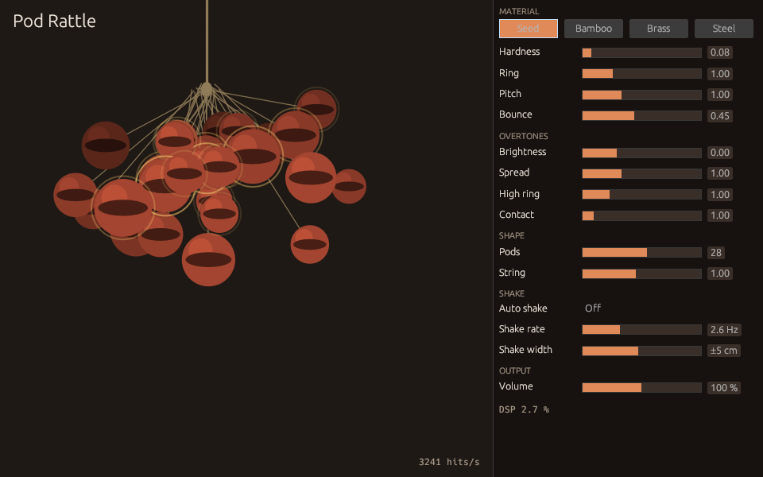

# Pod Rattle

種のさやを紐に付けて振る楽器を、[Web のページ](https://masseater.dev/pod-rattle/)と、Rust と [nice-plug](https://codeberg.org/RustAudio/nice-plug) で作った VST3・CLAP のプラグインにしたものである。
サンプルは使わず、紐に付いたさやが 3D の剛体シミュレーションでぶつかり、その衝突が素材に合わせたモードの共振器を鳴らす。



## 導入

[Releases](https://github.com/masseater/masseater.dev/releases?q=pod-rattle) の zip に、Windows・macOS（universal）・Linux 向けの `Pod Rattle.vst3` と `Pod Rattle.clap` が入っている。それぞれをプラグインのフォルダに写す。

| OS      | VST3                                 | CLAP                                 |
| ------- | ------------------------------------ | ------------------------------------ |
| Windows | `C:\Program Files\Common Files\VST3` | `C:\Program Files\Common Files\CLAP` |
| macOS   | `~/Library/Audio/Plug-Ins/VST3`      | `~/Library/Audio/Plug-Ins/CLAP`      |
| Linux   | `~/.vst3`                            | `~/.clap`                            |

macOS 版はアドホック署名で公証していないので、写したあとに一度だけ quarantine の属性を外す。

```sh
xattr -dr com.apple.quarantine ~/Library/Audio/Plug-Ins/*/Pod\ Rattle.*
```

## 演奏

MIDI のノートを受けるたびに、ラトルを反対側へ振って戻す。強さはベロシティで決まる。**Auto shake** を入れると、ラトルは **Shake rate** の速さで勝手に振れ、ノートを無視する。4 つの素材のボタンは Web 版と同じプリセットを読み、パラメータはすべてホストから自動化できる。

ラトルを持つ手の位置は **Hand X**（左右）・**Hand Y**（上下）・**Hand Z**（奥行き）で決まり、ノートと Auto shake はこの位置を中心に振る。ホストのオートメーションでこの 3 つを動かすと、手を動かしたとおりにさやが揺れて鳴る。エディタでラトルをドラッグすると Hand X と Hand Y が、ホイールを回すと Hand Z が変わるので、ホストの書き込みのモードで手の動きをそのまま録れる。

## 計測

下の値はすべて、main への push ごとに CI が `vp run verify` で確かめる。

| 項目                           | 測り方                                                                                                                                                         | 結果                                                                                                                                           |
| ------------------------------ | -------------------------------------------------------------------------------------------------------------------------------------------------------------- | ---------------------------------------------------------------------------------------------------------------------------------------------- |
| Web 版と同じ音                 | `libs/pod-rattle-engine/tests/parity.rs` が、Web 版のページから切り出した JavaScript のエンジンを Node.js で鳴らした音と比べる                                 | 最初の 0.45〜1.3 秒は標本単位で一致（誤差 1e-9 以内）。その後は V8 と Rust の演算の最下位の差でずれ、100 ms ごとの音量は 0.93〜1.04 倍に収まる |
| オーディオスレッドで確保しない | `libs/pod-rattle-engine/tests/no_alloc.rs` の `assert_no_alloc` と、debug ビルドの nice-plug の `assert_process_allocs`                                        | 通る                                                                                                                                           |
| 命令数の上限                   | `libs/pod-rattle-engine/benches/instructions.rs` が gungraun 経由の Valgrind で数える（さや 48 個、96 kHz、最速の振り）。音声 1 秒あたり 20 億を超えると落ちる | 音声 1 秒あたり 17.2 億                                                                                                                        |
| 1 インスタンスの負荷           | `cargo bench -p pod-rattle-engine` が最速・最大の振りで 48 kHz の 1 秒を描く                                                                                   | さや 28 個で 20〜25 ms（1 コアの 2〜2.5 %）、48 個で 40〜50 ms                                                                                 |
| プラグインの適合               | 3 OS で strictness 10 の `pluginval`（VST3）、Linux と macOS で `clap-validator`                                                                               | `pod-rattle` ワークフローの `bundle` ジョブ                                                                                                    |
| ホストからの自動化             | `tools/pod-rattle-host` が VST3 にノートと、Hand X・Y・Z の標本の位置を指定したオートメーションを送り、同じ時点で同じ値を渡したエンジンの音と比べる            | `pod-rattle` ワークフローの `bundle` ジョブ。4 つの場面すべてで差は 0                                                                          |

ベンチの値は 2.1 GHz の Intel Xeon で測った。エディタも DSP の負荷と 1 秒あたりの衝突の数を出す。

nice-plug とその VST3 のバインディングは ISC と MIT/Apache-2.0 で、AGPL のリポジトリと組み合わせて配れる。
