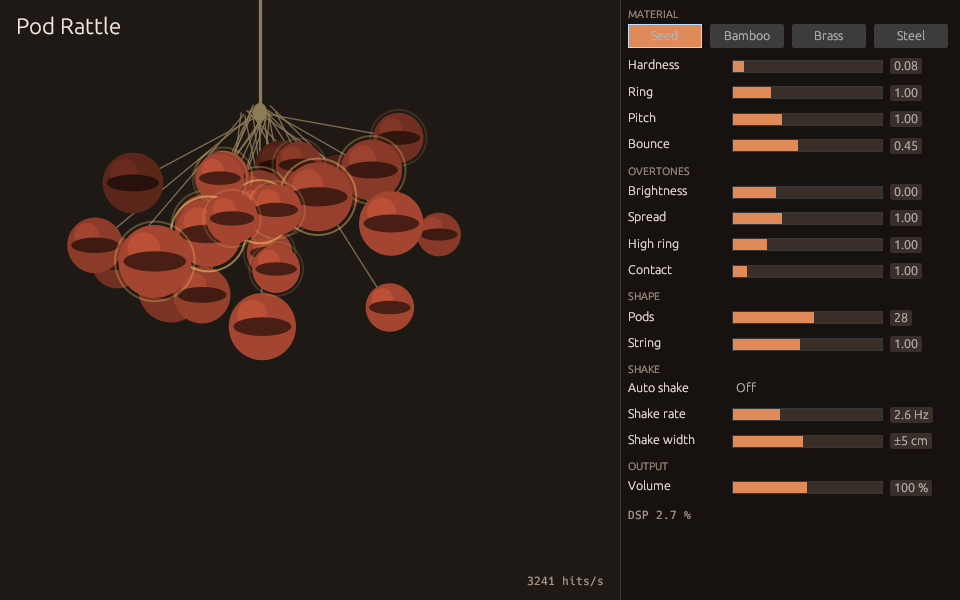

# Pod Rattle

A seed-pod rattle you shake, as a [web page](https://masseater.dev/pod-rattle/) and as a VST3 / CLAP instrument built in Rust with [nice-plug](https://codeberg.org/RustAudio/nice-plug). Plugin builds for Windows, macOS (universal) and Linux are attached to each [release](https://github.com/masseater/masseater.dev/releases?q=pod-rattle).

## Installing

The zip holds `Pod Rattle.vst3` and `Pod Rattle.clap`. Copy each into the plugin folder of your system.

| System  | VST3                                 | CLAP                                 |
| ------- | ------------------------------------ | ------------------------------------ |
| Windows | `C:\Program Files\Common Files\VST3` | `C:\Program Files\Common Files\CLAP` |
| macOS   | `~/Library/Audio/Plug-Ins/VST3`      | `~/Library/Audio/Plug-Ins/CLAP`      |
| Linux   | `~/.vst3`                            | `~/.clap`                            |

The macOS builds are ad-hoc signed, not notarized, so clear the quarantine flag once after copying them.

```sh
xattr -dr com.apple.quarantine ~/Library/Audio/Plug-Ins/*/Pod\ Rattle.*
```

## Sound

No samples: pods on strings collide in a 3D rigid-body simulation. Every collision excites a bank of modal resonators tuned by the material. It is a Rust port of the [Pod Rattle web demo](https://masseater.dev/pod-rattle/).



## Playing

Each MIDI note swings the rattle to the other side and back, and velocity sets how hard. With **Auto shake** on, the rattle swings by itself at **Shake rate** and ignores notes. You can also drag the rattle in the editor to shake it by hand. The four material buttons load the same presets as the web demo, and every slider is a host-automatable parameter.

## Measurements

Every claim below is checked by `vp run verify` at the repository root, which CI runs on each push to main.

| What                              | How it is measured                                                                                                                                                                                                                          | Result                                                                                                                                                                                              |
| --------------------------------- | ------------------------------------------------------------------------------------------------------------------------------------------------------------------------------------------------------------------------------------------- | --------------------------------------------------------------------------------------------------------------------------------------------------------------------------------------------------- |
| Same sound as the web demo        | `libs/pod-rattle-engine/tests/parity.rs` renders the scenarios in `tools/pod-rattle-parity/scenarios.json` and compares them with the JavaScript engine of the web demo, cut out of `apps/labs/pages/pod-rattle/index.html` and run by Node | Sample-identical (within 1e-9) for the first 0.45–1.3 s; afterwards the chaotic simulation drifts on last-bit differences between V8 and Rust math, and loudness per 100 ms stays within 0.93–1.04× |
| No allocation on the audio thread | `libs/pod-rattle-engine/tests/no_alloc.rs` with `assert_no_alloc`, and nice-plug's `assert_process_allocs` in debug builds                                                                                                                  | Passes                                                                                                                                                                                              |
| Instruction budget                | `libs/pod-rattle-engine/benches/instructions.rs` counts instructions with Valgrind through gungraun (48 pods, 96 kHz, fastest shake) and fails above 2.0 billion per second of audio                                                        | 1.72 billion per second of audio                                                                                                                                                                    |
| Cost per instance                 | `cargo bench -p pod-rattle-engine` renders 1 s at 48 kHz, fastest and widest shake                                                                                                                                                          | 28 pods: 20–25 ms (2–2.5 % of one core), 48 pods: 40–50 ms                                                                                                                                          |
| Plugin conformance                | `pluginval` at strictness 10 (VST3) on all three platforms, `clap-validator` on Linux and macOS                                                                                                                                             | See the `bundle` jobs of the `pod-rattle` workflow                                                                                                                                                  |

The benchmark numbers are from an Intel Xeon at 2.1 GHz. The editor also shows the live DSP load and collisions per second.

## Building

```sh
vp run @masseater.dev/pod-rattle-engine#cargo   # fmt, clippy, parity, tests, real-time checks
vp run @masseater.dev/pod-rattle-plugin#bundle   # target/bundled/Pod Rattle.{vst3,clap}
cargo run --release -p pod_rattle --features standalone   # Pod Rattle as a standalone app
```

The parity test needs Node.js to render the reference audio. On Linux, the editors need the X11, XCB and OpenGL development packages in `.github/actions/setup/linux-packages.txt`.

## License

AGPL-3.0-or-later, like the rest of the repository. nice-plug and its VST3 bindings are ISC and MIT/Apache-2.0 licensed, which the AGPL allows combining with.
