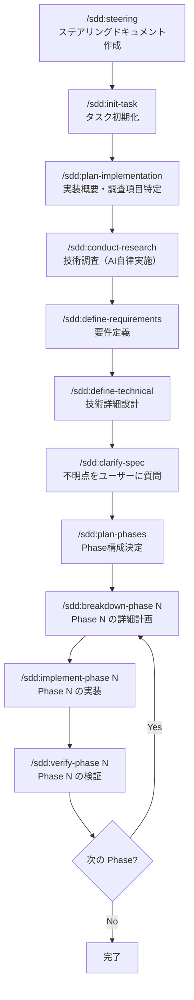

本記事は airCloset Advent Calendar 2025 の 13 日目の記事です。

https://qiita.com/advent-calendar/2025/air-closet

このアドベントカレンダーにはエンジニアを始めとして、弊社社員による様々な記事が投稿されるので、もしよければ他の記事もご覧ください。

## はじめに

Claude Code 使ってますか？使ってると思うので、Claude Code 自体の詳細な説明は省きます。

弊社では 2025 年の 6 月より全エンジニアに Claude Code のチームプランのプレミアムシート or Max 5x / 20x が支給されており、自分は 20x プランを日々使い倒しております。

日々 Claude Code を使用する中で、定型的な内容や毎回指示していることを slash command, hooks にしたり、常に使うわけじゃないけどたまに使う内容を skills にしたりなどを、自分のローカル環境でやってはいたのですが、複数 PC を切り替えたり流用可能な環境を構築しやすくするためにプラグイン化して GitHub に公開しております。

この記事では、そのプラグインにどういう機能を持たせているのかを紹介します。以下のリポジトリを marketplace に追加すればすぐ使用することが可能です。あくまで自分用なので急に全てが変わる可能性もあるので使用は推奨しませんが、よければ参考にしてください。

https://github.com/masseater/claude-code-plugin

このプラグインでは debug, sdd, mutils の 3 つのプラグインを提供しています。それらについて紹介します。

## debug

プラグイン開発時にデバッグするために作りました。これを有効にすると各イベント時に log を吐き出すだけの hook が有効になります。大したことしてないので割愛。詳細はコードを見てください。

https://github.com/masseater/claude-code-plugin/tree/main/plugins/debug

## sdd

いわゆる SDD, Spec Driven Development を実現するためのワークフローを提供するプラグインです。

仕様書駆動開発を実現するためのツールキットとしては、[cc-sdd](https://github.com/gotalab/cc-sdd), [spec-workflow-mcp](https://github.com/Pimzino/spec-workflow-mcp), そして [kiro](https://kiro.dev/) などが有名だと思いますが、それらとの差別点としては、ドキュメントと実装が正しいかどうかを確認するためのコマンドと SubAgent を用意している点です。

- `/sdd:contradiction-check`: 仕様書間の矛盾を検出します。overview.md と technical-details.md で異なることを言っていたら警告が出ます。ただし修正は自動で行わず、指摘のみ。修正をどうするかはユーザーが判断します。
- `/sdd:verify-phase`: Phase 完了時に「ドキュメントと実装が一致しているか」「要件を満たしているか」「コード品質は問題ないか」を統合検証します。
- Hooks による自動チェック: アーカイブ済みタスクの誤編集をブロック、Phase 計画書からステータス表記を削除しようとすると警告を出すなど、ワークフローの逸脱を防ぎます。

このドキュメントは単なる記録ではなく、Claude Code が実装時に参照するコンテキストになります。仕様と実装が常にリンクしている状態を維持できます。

また spec-workflow-mcp ライクな Web アプリも構築して npm に公開しています。こちらはまだ構築が不十分で、満足に動作していないのであくまでおまけです。

### 詳細

全体像としては以下になります。



また以下のようなドキュメント構造が生成されます。

```
specs/
├── _steering/           # プロジェクト全体の永続コンテキスト
│   ├── product.md       # プロダクト方針、ビジネス目標
│   ├── tech.md          # 技術スタック、開発標準
│   └── principles.md    # 開発原則
├── {taskname}/          # 各タスク
│   ├── overview.md      # 概要、Phase構成、調査状況
│   ├── specification.md # 機能要件・非機能要件
│   ├── technical-details.md # 技術仕様・設計
│   └── tasks/
│       ├── phase1-*.md  # Phase 1 の詳細計画
│       ├── phase1-*.md  # Phase 2 の詳細計画
│       └── phasen-*.md  # Phase n の詳細計画
└── research/            # 技術調査結果
    └── *.md
```

### sdd-webapp について

## mutils

日々の開発で「毎回同じことを指示している」「忘れがち」な作業を自動化するユーティリティ集です。

以下にプラグインで提供している機能を紹介します。

### AGENTS.md, CLAUDE.md に参照を追加するための /mutils:setup

Claude Code の plugin では CLAUDE.md 相当の常に参照されるコンテキストを注入することはできませんが、ファイルパスへの参照を追加することでそのファイルをコンテキストに注入することができます。

なのでプラグインディレクトリにそのコンテキストファイルを含めつつ、setup コマンドで AGENTS.md, CLAUDE.md にそのコンテキストファイルへの参照を記載するためのコマンドを提供しています。これにより mutils に自分が記載しているコンテキストに半自動で同期することができます。

### 並列エージェント起動によるセルフレビュー /mutils:self-review

コードを書いた後、自分でレビューするのは難しいです。書いた本人は「正しいはず」と思っているので、問題を見落としがちです。

mutils では4つの専門エージェントを用意しています。

- **design-reviewer**: 設計観点（単一責任、循環依存、密結合）
- **implementation-reviewer**: 実装観点（可読性、重複コード、命名）
- **type-safety-reviewer**: TypeScript の型安全性（any 禁止、型ガード）
- **goal-validator**: 当初の目的を達成しているか

`/mutils:self-review` を実行すると、これらが並列で実行されます。それぞれ異なる観点でチェックするので、自分では気づかない問題が見つかります。

### コンテキストファイルの適切（？）な分割 /mutils:refactor-context-file

CLAUDE.md（または AGENTS.md）は便利ですが、使い続けると肥大化します。技術スタック、コーディング規約、プロジェクト固有のルール、よく使うコマンド... すべてが1ファイルに詰め込まれて読みにくくなります。

`/mutils:refactor-context-file` は、肥大化したコンテキストファイルを Claude Code の機能別（commands, agents, skills, rules, hooks）に分解します。関心ごとに分離されることで、編集も参照もしやすくなることを期待しています。

### 進捗・知見の記載

#### {filename}.mutils_knowledge.md による知見の蓄積 (hook)

ファイルを編集していると「この実装で気をつけること」「このファイル特有の注意点」が見つかることがあります。その場でメモしないと忘れますが、わざわざドキュメントを書くのも面倒です。

mutils では、ファイル編集後に「知見や注意点があれば `{filename}.mutils_knowledge.md` に記載してください」と提案しています。あくまで提案なので書かない時もそれなりにあるので、どうにか改善せねばなと思っています。

#### 進捗の追跡 (hook, skill)

Claude Code はセッションが切れるとコンテキストがリセットされます。「昨日どこまでやったっけ」を思い出すのに時間がかかります。

mutils では、セッション終了時に進捗を `.agents/progress/` に記載するように Stop Hook で指示をします。さらに SQLite でセッション履歴を索引化しているので、過去のセッションを検索できます。

`progress-files` スキルという、進捗ファイルの存在を伝えるためのスキルと、`semtools` という自然言語でローカルファイルの検索ができるツールのスキルを提供しているため、よしなに過去ファイルを検索することができるようになっています。

### Git Push 後の処理を指示する hook

`git push` が実行された後、CI の監視と品質チェックの実行を提案します。PostToolUse イベントで Bash ツールの実行を監視し、`git push` コマンドが成功した場合にメッセージを返します。

https://github.com/masseater/claude-code-plugin/blob/main/plugins/mutils/src/hooks/post-tool-use/git-push-hook.ts

### CLAUDE.md の編集をブロックする hook

CLAUDE.md は `@AGENTS.md` の1行だけにして、実体は AGENTS.md に書く運用にしています。これにより、プラグインから注入したコンテキストと競合しないようにしています。

PreToolUse イベントで Edit/Write ツールの実行を監視し、CLAUDE.md への編集をブロックします。直近 AGENTS.md が AAiF に寄贈されたこともあり、今後は CLAUDE.md の直接編集はさけて AGENTS.md の編集を行うようにしています。

https://github.com/masseater/claude-code-plugin/blob/main/plugins/mutils/src/hooks/pre-tool-use/block-claude-md-edit.ts

## 共通ライブラリ

Hooks は TypeScript + Bun + [cc-hooks-ts](https://github.com/sushichan044/cc-hooks-ts) で実装しています。cc-hooks-ts は sushichan さんが作成したライブラリで、型安全な Hook 開発ができます。

### 並行実行の問題

Hooks 開発で困るのは、**複数の Claude Code インスタンスが同時に実行される**ことです。ターミナルを複数開いていたり、VSCode と CLI を併用していると、同じ Hook が並行で動きます。

ログをファイルに書き込むとき、普通に書くと出力が混ざって読めなくなります。また、例外が発生したときのスタックトレースもバラバラになります。

### cc-plugin-lib

この問題を解決するために `cc-plugin-lib` というライブラリを作りました。npm で公開しています。

**HookLogger**: pino を使って JSON 行単位で原子的に書き込みます。1行が PIPE_BUF 以下なら OS が原子性を保証するので、複数プロセスから同時に書いても混ざりません。ログは `~/.local/state/masseater-plugins/{hookName}/` に日別で保存され、古いログは自動削除されます。

**wrapRun**: Hook の `run` 関数をラップして、開始・終了・例外をログに記録します。例外時はスタックトレースも含めて記録されるので、デバッグが楽になります。

```typescript
import { HookLogger, wrapRun } from "@r_masseater/cc-plugin-lib";
import { defineHook, runHook } from "cc-hooks-ts";

using logger = HookLogger.fromFile(import.meta.filename);

const hook = defineHook({
  trigger: { Stop: true },
  run: wrapRun(logger, (context) => {
    logger.info("Something happened");
    return context.success({});
  }),
});

if (import.meta.main) {
  await runHook(hook);
}
```

`using` 構文（TypeScript 5.2+）を使っているので、スコープを抜けると自動でクリーンアップされます。

## 終わりに
