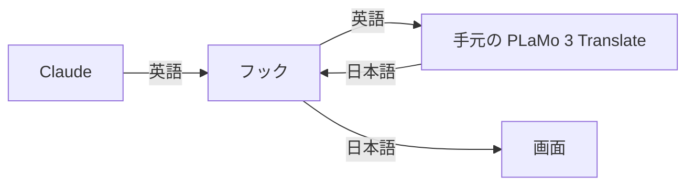

Claudeが書く日本語はカスです。skillとかで指示しても結局カスです。なのでそもそも英語で出力させた上で、plamoで翻訳する形式を試してみて、いい感じだったのでプラグインとして公開します。

なおこのプラグインは以下の投稿を参考にさせていただきました。

https://x.com/kat0h/status/2118175639262175376

<!-- TODO(media): ここにイントロ動画付きのツイートを埋め込む -->

## 簡易仕組紹介



Claude Code の[フック](https://code.claude.com/docs/en/hooks)だけで動いています。

| フック           | やっていること                                                          |
| ---------------- | ----------------------------------------------------------------------- |
| `SessionStart`   | `llama-server` を起動し、`additionalContext` で Claude に英語で書かせる |
| `MessageDisplay` | 返信を表示の直前に訳し、`displayContent` で差し替える                   |
| `PreToolUse`     | `AskUserQuestion` などの入力を訳し、`updatedInput` で差し替える         |
| `PostToolUse`    | 差し替えが通ったかを記録する                                            |

`MessageDisplay` が変えるのは表示だけなので、Claude の文脈は英語のままです。コードとバッククォートの中は訳しません。詳細は[コード](https://github.com/masseater/skills/tree/main/plugins/plamo-ja)を見てください。

## 実際の出力での比較

> Claude の返事の最後の行が、日本語の表示から消えることがある。原因を調べて直して。

### 報告の締めの部分

素の Claude

> **まだ反映されていません**
> このリポジトリにはリモートがないので、修正はローカルの master への commit（`d089f03`）だけです。PR は作れていません。配布元の masseater/skills の `plugins/plamo-ja` に入れるまで、各セッションには反映されません。そちらに PR を出してよければ、その作業をします。

plamo-ja

> コミットはブランチ `fix/keep-last-line` の `1ffeee1` です。このリポジトリにはリモートがないため、PRの作成やマージができませんでした。

:::details Claude が書いた英語
> The commit is `1ffeee1` on branch `fix/keep-last-line`.
> This repository has no remote, so I could not open a PR or merge.
:::

### 原因の説明の部分

素の Claude

> **原因**
> `hooks/lib/render.ts` の `splitLines` は、改行で終わる行しか拾っていませんでした（`/[^\n]*\n/g`）。Claude の返事は最後の行の後ろに改行が付かないことが多く、その行だけが訳す対象から外れて画面に出ていませんでした。`"Partial"` を渡すと `""` が返ってくることで確かめました。既存のテスト「末尾に改行の無い行も改行を足さずに出す」もこの不具合で失敗する状態でした。

plamo-ja

> 原因は `hooks/lib/render.ts` の `splitLines` で、テキストを行分割してから翻訳していました。
> パターン `/[^\n]*\n/g` は、改行で終わる行のみを保持していました。返信の最後の行は通常、その後に改行が入らないため、翻訳に届かず表示から除外されていました。

:::details Claude が書いた英語
> The cause was `splitLines` in `hooks/lib/render.ts`, which split text into lines before translating.
> Its pattern `/[^\n]*\n/g` only kept lines that end in a newline.
> The last line of a reply usually has no newline after it, so it never reached translation and was dropped from the display.
:::

### 長い文書の冒頭

依頼は「新しく入る人向けに、hooks がどの順に何をしているかを説明して。」です。

素の Claude

> Claude には英語で書かせます。ユーザーに見える直前に、hooks がローカルの PLaMo 3 Translate（llama-server）で日本語に訳します。transcript と Claude の文脈は英語のまま残ります。
>
> hooks は `hooks/hooks.json` に 4 つ登録されています。

このあと表、入れ子の箇条書き、括弧書きが続きます。

plamo-ja

> Claudeは英語で記述し、ローカルのPLaMo 3 Translateサーバーがその英語をユーザーが目にする日本語に変換します。フックは4つあり、すべて `hooks/hooks.json` に登録されており、それぞれが `node` を含む `.ts` ファイルを実行します。

このあとは見出しと段落だけで続きます。全文は動画で流しています。

## 弱点

- 0.8B のモデルが動く PC が要ります。モデルは 573 MB、メモリは約 1.5 GB 使います。GPU のない 4 コアの Claude Code のクラウド環境で動いたので、だいたいの PC で動くはずです。
- 返信が遅れます。上の 15 行の報告で約 8 秒でした。
- 誤訳します。PLaMo は 1 行ずつ訳すので、コードの文脈を知りません。
- 自動で入るのは Linux x64 と macOS arm64 だけです。Windows では `llama-server` を自分で起動します。

実際に出た誤訳です。

| Claude が書いた英語                                        | PLaMo の訳                                                    |
| ---------------------------------------------------------- | ------------------------------------------------------------- |
| I added a multi-line case to the same test.                | 同じテストに複数行の大文字小文字を付け加えました。            |
| If a result looks broken, it retries once without history. | 結果がリンク切れに見える場合は、履歴なしで1回再試行されます。 |
| sizes from 0.8B to 31B                                     | パラメータ数は0.80億から310億まで                             |

怪しいときは `/plamo-ja:display off` で英語を読みます。

## インストール

```
/plugin marketplace add masseater/skills
/plugin install plamo-ja@masseater
```

:::message alert
有効にした状態でセッションを始めると、`SessionStart` フックが `llama-server` とモデル（573 MB）を確認なしでダウンロードし、`~/.cache/plamo-ja/runtime` に置いて起動します。対象は Linux x64 と macOS arm64 です。
:::

`/plamo-ja:display` で有効になります。モデルの利用は [PLaMo Community License](https://plamo.preferredai.jp/info/plamo-community-license-ja) に従います。動画の声は VOICEVOX:ずんだもんです。
